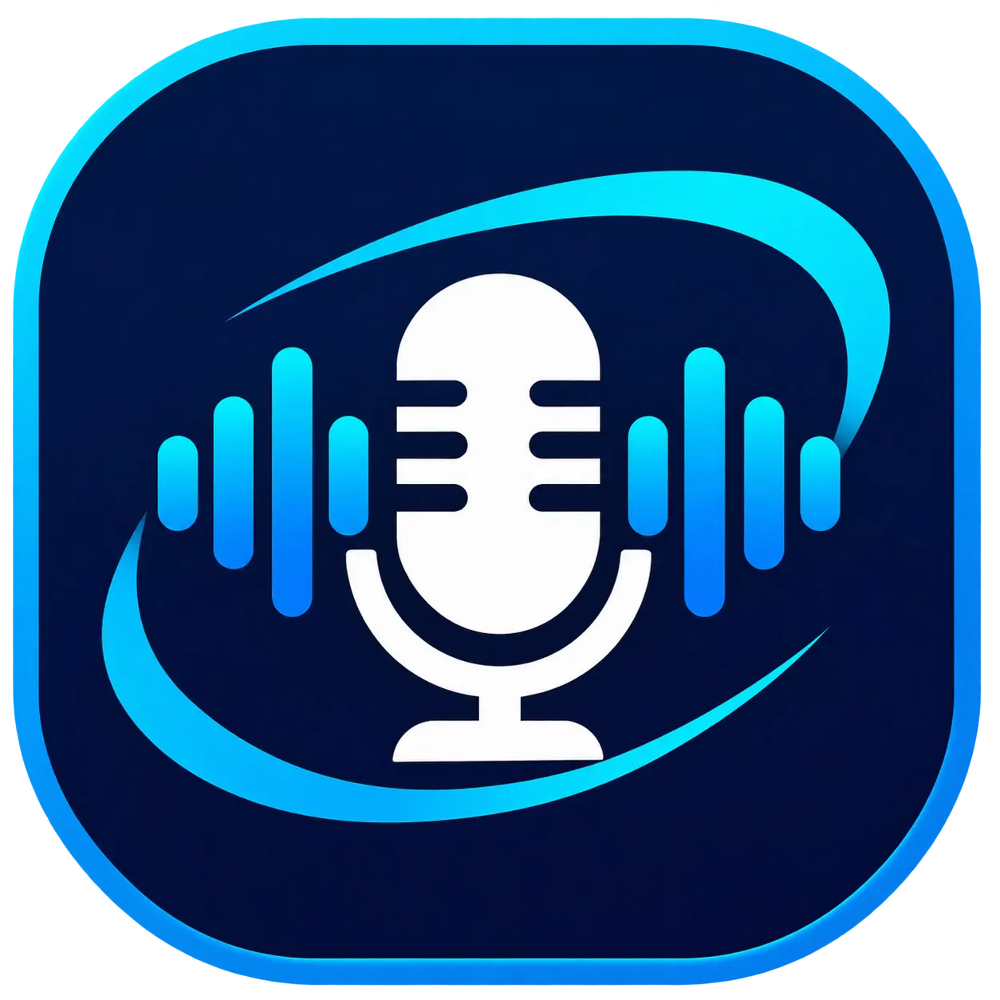

<div align="center">
  <h1><sub></sub> VOCA</h1>
  <h3>Voice on Computer, on Android. A lean, fast, offline voice studio for your phone.</h3>
  <p>Clone, design, dub, dictate, transcribe and narrate in 646 languages, on the device in your pocket.</p>
</div>

VOCA is a fork of [VoiceStudio](https://github.com/debpalash/VoiceStudio), the
open-source, fully local alternative to ElevenLabs. VoiceStudio is a desktop
app first. VOCA puts the **Android app** first and makes it small, fast to
start and smooth on everyday phones.

## Project goals

1. **Phone first, offline first.** Every feature runs on the phone once its
   models are downloaded. No account, no cloud, no API keys. Pairing with a
   VoiceStudio computer is optional and adds the heavier engines.
2. **Lean.** The app you install should carry only the code, resources and
   native libraries your phone actually uses.
3. **Fast.** Cold start and first screens should feel instant, including on
   mid-range phones and on the very first launch.
4. **Built for touch.** Layouts are designed for small touchscreens first and
   scale up to tablets.
5. **Stay compatible with upstream.** VOCA follows VoiceStudio's shared mobile
   contract (`mobile/contract/SPEC.md`), so upstream improvements keep merging
   cleanly.

## Size and speed work

These are in place in the Android build (`mobile/android`):

| Optimization | What it does | Where |
| --- | --- | --- |
| R8 code shrinking | Release builds drop unused Kotlin, Compose and library code and optimize the rest. | `app/build.gradle.kts`, `app/proguard-rules.pro` |
| Resource shrinking | Unused images, layouts and strings are removed from release builds. Resources loaded by name are kept explicitly. | `app/src/main/res/raw/keep.xml` |
| Per-ABI APKs | Release APKs are split so a phone download carries only arm64 native libraries, not emulator (x86_64) ones as well. | `app/build.gradle.kts` |
| Baseline profile | The app's own code is compiled ahead of time on install, including sideloaded APKs, for faster cold start and first frames. | `app/src/main/baseline-prof.txt` |
| Faster builds | Gradle runs in parallel with the build cache on. | `gradle.properties` |

Next on the list: generate a measured baseline profile with Macrobenchmark,
and track APK size and startup time in CI so regressions are caught.

## What it does

- **Text to speech** in many languages with on-device models.
- **Voice cloning** from a short, clean reference recording.
- **Voice design**: describe a voice in words and generate it.
- **Dictation and transcription**, fully offline.
- **Dubbing**: translate speech and re-voice it.
- **Optional computer pairing** to use larger models on your own machine.

## Build the Android app

Requirements: JDK 21, Android SDK platform 36, NDK 27.1.12297006 and CMake
3.22.1. Minimum device: Android 10 (API 29).

```sh
cd mobile/android
printf 'sdk.dir=%s\n' "$ANDROID_HOME" > local.properties
./gradlew assembleDebug          # debug APK
./gradlew assembleRelease        # shrunk release APKs, one per ABI
./gradlew bundleRelease          # Play bundle (run separately from assembleRelease)
./gradlew testDebugUnitTest lint
```

The phone APK is `app/build/outputs/apk/release/app-arm64-v8a-release*.apk`.
More detail is in [mobile/android/README.md](mobile/android/README.md).

## The rest of the repository

The desktop app (Electron), Python backend, iOS app, CLI and Docker images
come from upstream VoiceStudio and are kept in sync. Their documentation is in
[docs/](docs/), and VoiceStudio's original README is preserved at
[VOICESTUDIO_README.md](VOICESTUDIO_README.md).

## Credits and license

VOCA is built on [VoiceStudio](https://github.com/debpalash/VoiceStudio) by
Palash Debnath and its contributors. All credit for the engines, apps and
models goes to them.

[AGPL-3.0](LICENSE), the same license as upstream. Model weights, voices and
generated output have their own licences ([inventory](docs/licensing/model-inventory.md)).
Clone a voice only with its owner's permission. Details:
[LICENSE-NOTICE.md](LICENSE-NOTICE.md).
